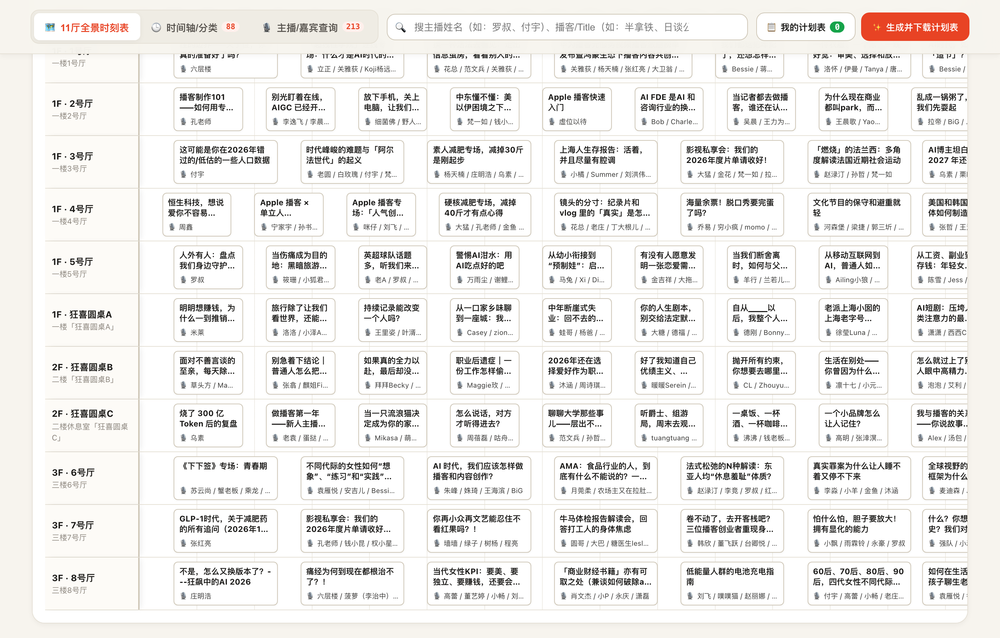
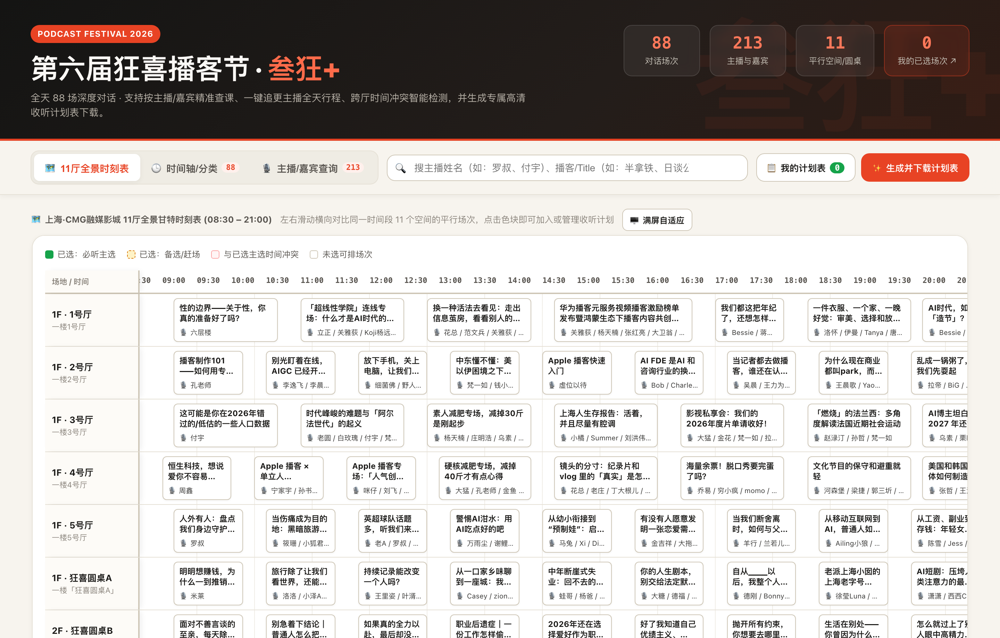

# 🎙️ 第六届狂喜播客节 · 全景时刻表与收听规划系统

> **88 场对话 · 11 个影厅空间 · 140+ 位播客主理人 · 9 大核心话题**  
> 为狂喜播客节听友量身定制的全景漫游时刻表与个性化收听规划助手。

[](https://kuang-xre.pages.dev)
[](LICENSE)
[](#技术架构)

🌐 **在线体验网址**：[https://kuang-xre.pages.dev](https://kuang-xre.pages.dev)  
📦 **GitHub 仓库**：[https://github.com/alili/kuang](https://github.com/alili/kuang)

---

## 📸 实机界面预览

| 🏛️ 11厅全景时刻表与9大话题排期 | 🎨 Canvas 高清个性化海报长图工作室 |
| :---: | :---: |
|  |  |

---

## 🌟 系统核心特色

### 1. 🏛️ 11 厅全景全天排期与矩阵漫游
- **全空间覆盖**：精准映射 **上海·CMG融媒影城** 3 层楼共 11 个会场空间：
  - **1F**：1号厅（巨幕）、2-5号厅、狂喜圆桌A（户外草坪）
  - **2F**：狂喜圆桌B、狂喜圆桌C
  - **3F**：6号厅、7号厅、8号厅
- **双视图自由切换**：
  - **按时段流式浏览**：全天 10 个时间段无缝平铺，两行完整标题展现，信息一目了然。
  - **按 9 大话题分类分组**：支持在「商业创投、文化文艺、生活方式、科技AI、情感两性、影视娱乐、社会心理、健康运动、职场成长」中一键切换排期。
- **全景时空矩阵（Panorama Matrix）**：横向铺开 11 个影厅，纵向延伸全天时间轴，跨厅同屏对比，全方位纵览全局。

---

### 2. ⚡ 智能冲突预警与「主选 / 备选」调度
- **无死角冲突检测**：加入心仪场次时，系统实时计算全天时间重叠分钟数，提供换场间隔预警（如：10 分钟紧凑跨楼层换场）。
- **极简两键决策弹窗**：遭遇时间冲突时无需繁琐操作，直接触发定制冲突弹窗：
  - ⭐ **替换为主选**：自动将原有时段场次替换，保证单一时段只有一个必听主选。
  - 📌 **设置为备选**：保留为赶场/候补席位，双保险不错过任何精彩现场。
- **数据本地持久化**：所有规划与自定义备忘均保存在本地浏览器（`localStorage`），无需注册登录，刷新页面不丢失。

---

### 3. 🎙️ 140+ 播客主理人全天动线追踪
- **主播雷达**：收录全天参会的所有主播、主理人及其代表播客节目。
- **一键跟人**：在场次卡片中点击任意主播姓名，即可瞬间弹出该嘉宾的全天通告与出镜排期，支持一键加入个人计划表。

---

### 4. 🎨 全能海报导出工作室（Export Studio）
内置基于 **HTML5 2× Retina Canvas** 的离线高清海报生成引擎，无需上传云端，毫秒级实时生成长图，提供多种极具个性和审美风格的主题：

| 风格名称 | 核心设计语言 | 适用场景 |
| :--- | :--- | :--- |
| **⚡ 狂喜朋克 (Punk)** *(默认)* | 官方主视觉粉蓝朋克、荧光高饱和配色、高质感多重描边 | 狂喜播客节官方同款、最出片的社交圈长图 |
| **🎬 片场计划 (Film Set)** | 经典警示黄黑高反差、场记板条纹、现场录制 CALL SHEET | 电影/片场控、特工通告单感 |
| **🧾 狂喜超市小票 (Receipt)** | 热敏纸质感、锯齿撕边、条形码交易单据、单品配料表 | 极简生活方式、文青票据手账控 |
| **🔍 探案线索板 (Crime Scene)** | 深度暗调松木板、手撕纸便签、红色工字钉与红绳线索网络 | 悬疑故事播客迷、侦探案件调查手记 |
| **🔥 经典黑金 (Festival Gold)** | 深邃哑光黑底衬托雅致亮金、经典黑金电台风 | 典雅商务、尊贵低调 |
| **📜 暖米手账 (Vintage Paper)** | 泛黄牛皮纸肌理、柔和米色、手账拼贴感 | 手账达人、复古怀旧感 |
| **☀️ 清爽白昼 (Clean Slate)** | 极简白色素雅排版、高对比度排期网格 | 清爽干净、适合打印与快速查看 |

海报可选功能：
- 自定义听友昵称与今日宣言。
- 自主勾选是否附带官方合作伙伴墙及购票核销二维码。
- 自动计算并展示：必听主选场次、备选赶场场次、累计沉浸时长（小时/分钟）、捕获主播人数。

---

### 5. 📅 全格式多端导出能力
除了高清图片导出，还支持多种数据输出方式：
- **📅 手机/电脑日历 (.ICS)**：一键导出 iCalendar 标准日历文件，直接批量写入 iPhone、Mac Calendar、Google 日历，带准点开场闹铃提醒。
- **📊 个人专属课表 (.CSV)**：标准 CSV 格式，方便在 Excel / Numbers / Notion 中编辑与归档。
- **📋 一键复制文字版**：格式化排版的纯文本日程，方便随手粘贴至微信群、即刻、小红书与听友讨论。
- **🖨️ 浏览器原生打印 / PDF 导出**：针对 A4 纸打印专门优化了 `@media print` 样式。

---

## 🛠️ 技术架构

- **零依赖原生纯前端**：纯使用原生 HTML5、CSS3 与 Modern JavaScript (ES6+)，无任何第三方重型框架，页面初始包体轻盈，首屏极速秒开。
- **离线与轻量**：离线包含完整 88 场节目的元数据（展厅、楼层、时段、话题分类、嘉宾播客信息），弱网或无网络环境下依然可用。
- **响应式排版**：完美适配 iPhone / Android 移动端触屏手势、长按保存图片，并对 PC 宽屏及大屏投影做了针对性优化。
- **云原生极速部署**：一键托管于 Cloudflare Pages 边缘网络，全球毫秒级分发。

---

## 🚀 本地开发与运行

本项目无需 `npm install` 编译，开箱即用：

```bash
# 1. 克隆仓库
git clone https://github.com/alili/kuang.git
cd kuang

# 2. 本地启动简易 HTTP 服务（任选一种）
# 方式 A：Python 3
python3 -m http.server 8080

# 方式 B：Node.js npx
npx serve .

# 方式 C：直接在浏览器中打开 index.html
open index.html
```

在浏览器中打开 `http://localhost:8080` 即可体验。

---

## 📁 目录结构

```text
kuang/
├── index.html       # 核心页面结构、导航、筛选控制器及弹窗模态框
├── app.js           # 业务逻辑、状态管理、冲突计算、Canvas 7套海报渲染引擎、ICS/CSV 导出
├── data.js          # 完整数据源：88场对话排期、11厅空间元数据、9大话题分类、主播花名册
├── styles.css       # 全响应式样式、狂喜朋克霓虹视觉、票据锯齿等拟物化样式
└── assets/          # 官方海报头图、二维码、合作伙伴横幅等静态视觉资源
```

---

## 🤝 声明

本项目为 **第六届狂喜播客节 · 叁狂+** 听友共建开源项目，日程与嘉宾信息归狂喜播客节官方所有。

祝各位听友在 CMG 融媒影城打捞一整天的声音奇遇，尽情狂喜！🎧⚡
